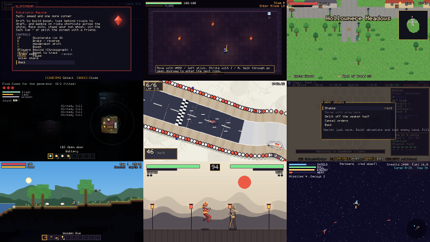
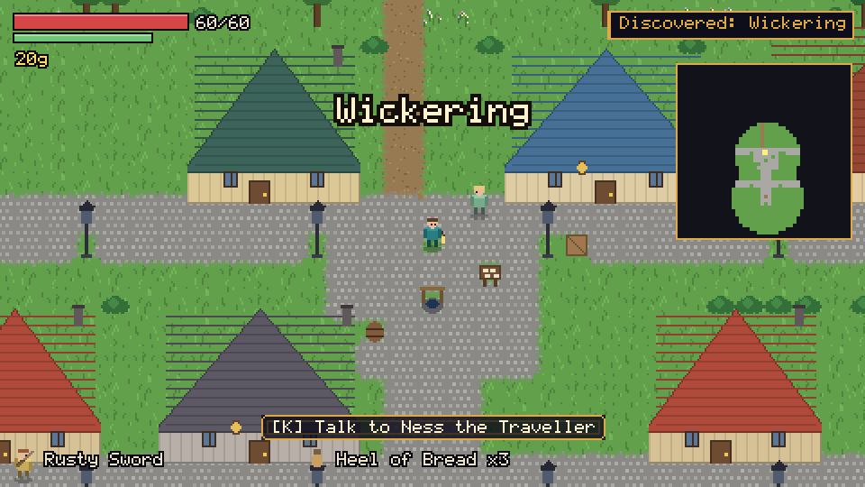
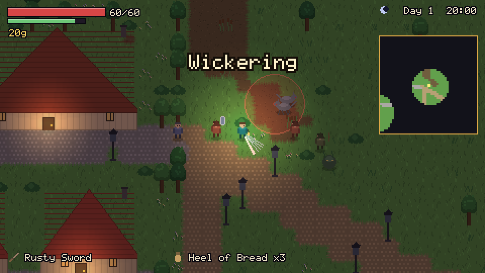
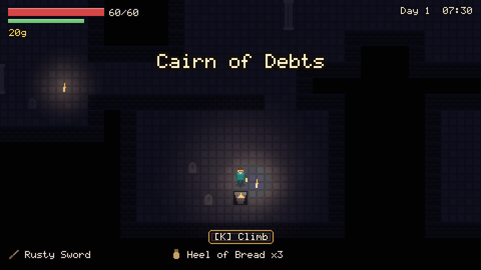
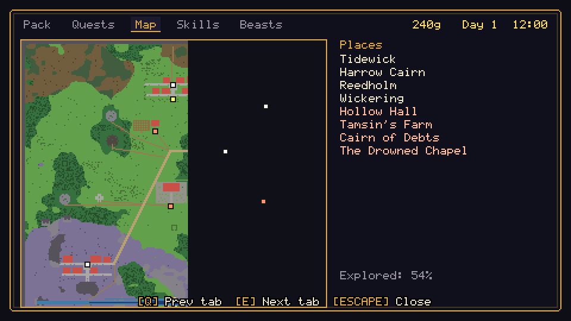

<div align="center">

# SHARDLIGHT

### Eight fractured worlds around one broken lens.

A Python / pygame-ce game containing eight different genres, a walkable hub, one shared save, and a web of cross-world consequences. Every sprite, song, sound and world in it is generated by code.

[](https://github.com/shipking-ai/shardlight/actions/workflows/ci.yml)




*Hub, Slipstream, Cinder, Verdant, Umbra, Concord, Terrace, Masks and Orrery, captured from real gameplay by [`tools/contact_sheet.py`](tools/contact_sheet.py).*

</div>

> **Read this first, because it is the honest part.** The project has about 50,000 lines of code and 419 automated tests that pass. **No one has played any of the eight games by hand, listened to its audio, or used a real game controller.** Everything described below was verified by tests, scripted bot play, measurements and screenshots, not by hands and ears. Balance numbers are first drafts. See [docs/STATUS.md](docs/STATUS.md) and [docs/KNOWN_ISSUES.md](docs/KNOWN_ISSUES.md) for the full, itemised truth.

## The eight shards

| shard | genre | what's in it (all covered by automated tests) |
|---|---|---|
| **Cinder** | action roguelike | five floors, parry and dodge i-frames, weapons that evolve with how you fight, 29 boons that trade power for risk, enemies that telegraph everything and adapt within bounds |
| **Verdant** | open-world RPG | a seeded 256x256 countryside with four towns, 21 villagers on daily schedules, 11 quests, four bosses, shops, crafting, lamps that hold the night back |
| **Umbra** | psychological horror | procedurally built buildings proven solvable, light-and-sound stealth, three enemy senses, a pacing director, an enemy that learns where you hide |
| **Slipstream** | futuristic racing | drift-to-boost, drafting, risky shortcuts, rivals bound by the player's own limits, ghosts, a championship, two-player split screen |
| **Concord** | strategy and empire sim | hex campaign with real supply logistics, diplomacy whose AI acceptance is explained to you, tactical battles, AI houses with fog-of-war memory |
| **Terrace** | sandbox survival | 512x256 destructible world, light propagation, conserved-volume fluids, a living ecology, the Keystone and the Vigil |
| **Masks** | 2D fighting game | six fighters with validated frame data, a deterministic integer simulation, training mode, tamper-evident replays, CPU with reaction delay, local versus |
| **Orrery** | space exploration and civilisation sim | ~80-system galaxy, five civilisations with a goods-conserving economy, ship combat, signal triangulation and decoding puzzles |

Per-shard pages with controls, what is verified, and what is partial or missing: [docs/modes/](docs/modes/).

### A closer look at Verdant (the newest shard)

| | |
|---|---|
|  |  |
|  |  |

## How the worlds touch each other

Modes never import one another. They emit events (`orrery.signal_decoded`, `cinder.boss_defeated`, `verdant.quest_completed`...) and a data file ([`data/echo/spine.json`](data/echo/spine.json)) turns them into consequences elsewhere: decoding a signal in Orrery makes a hidden ring of stones appear on Verdant's moor; exploring them wakes a boss in Cinder; defeating that boss teaches Concord's smiths and Terrace's builders something new; a repaired debt in Verdant lets you carry a ward in Umbra. [`tests/test_echo_web.py`](tests/test_echo_web.py) drives the whole chain through the real engine and checks that every unlock has a consumer.

## Quick start

Windows, Python 3.12:

```bat
play.bat
```

That creates a virtual environment, installs the two runtime dependencies, renders the procedural audio once (about a minute; the 47 MB of WAVs are deliberately not stored in git), and starts the game. Or by hand:

```bat
py -3.12 -m venv .venv
.venv\Scripts\python.exe -m pip install -r requirements.txt
.venv\Scripts\python.exe tools\gen_audio.py
.venv\Scripts\python.exe -m shardlight
```

Without `gen_audio.py` the game still runs (sound effects fall back to their built-in recipes) but there is no music.

Useful flags: `--mode verdant` (jump into a shard), `--slot 1`, `--seed 42`, `--no-audio`, `--debug` (F3 overlay), `--headless --frames 300 --screenshot out.png`.

On Linux, the full test suite (headless, dummy video and audio drivers) passes in CI, but nobody has actually *played* it there; macOS has not been tried at all.

## Controls

Two keyboard schemes and any SDL game controller (button prompts adapt to the device you used last). Everything is rebindable in **Controls**.

| action | keyboard A | keyboard B | gamepad |
|---|---|---|---|
| move | W A S D | arrow keys | left stick / d-pad |
| A / B / X / Y | J / K / U / I | , / . / M / N | A / B / X / Y |
| L / R | Q / E | [ / ] | LB / RB |
| confirm / back | Enter, Space, J / Esc, Backspace, K | Enter / Esc | A / B |
| pause | Esc, P | Esc | Start |
| F11 fullscreen, F12 screenshot, F3 debug | | | |

Slipstream (split screen) and Masks (versus) assign scheme A to player 1 and scheme B or a second controller to player 2; unplugging a controller pauses the match. *Controller handling is tested with synthetic devices only.*

## Accessibility

Reduce screen shake, reduce flashes, high-contrast UI, colour-assist filters (protan / deutan / tritan), large text, a game-speed slider, hold-to-toggle inputs, aim assist, three difficulty presets and an adaptive-AI strength slider (0 disables adaptation). All in Settings.

## What makes the engineering interesting

* **Deterministic, validated procedural generation everywhere.** Worlds, tracks, floors, galaxies and dungeons derive from labelled RNG streams, are checked for solvability or reachability, repaired where possible, and compared by digest in tests.
* **Bounded, visible, switch-off-able adaptive AI.** Enemies counter your habits through one shared controller with caps, slew limits and cooldowns; the counters are things you can see (a shield, an archer that closes in), never hidden damage multipliers.
* **Data-driven content.** 757 JSON entries in 41 schema-validated kinds; data-only mods with dependency, conflict and explicit-override rules (no mod code is ever executed). [`examples/sample_pack`](examples/sample_pack) adds a Verdant NPC with a quest, items, a recipe and an Umbra note. It is an example, shipped disabled: copy the folder into `mods/` (or point `SHARDLIGHT_MODS` at it) to enable "Ness the Traveller" in Wickering.
* **Original audio, rendered offline.** Ten looping three-layer scores and 167 sound effects synthesised from NumPy, verified for loop seams, clipping and loudness, with a hashed manifest. Building the pipeline exposed a bug that had broken every track and 13 sounds that were silently failing in-game; [the story is in the dev log](docs/DEVLOG.md).
* **Cheap to run.** One frame of update plus draw costs 0.7-2.3 ms per shard in a headless harness (no vsync or window included) on the development machine.
* **Save safety.** Versioned JSON with SHA-256 envelope, atomic writes, rolling backups and recovery; never pickle.

## Running the checks

```bat
.venv\Scripts\python.exe -m pytest tests -q          # 419 tests, about 5 minutes
.venv\Scripts\python.exe tools\perf.py               # frame cost per shard, real gameplay
.venv\Scripts\python.exe tools\contact_sheet.py      # regenerate the screenshots above
.venv\Scripts\python.exe tools\gen_audio.py --check  # audio manifest integrity
```

The audio tests skip themselves if you have not rendered the audio yet.

## Documentation

| | |
|---|---|
| [docs/STATUS.md](docs/STATUS.md) | verified claims, per shard and per system, with measurements |
| [docs/KNOWN_ISSUES.md](docs/KNOWN_ISSUES.md) | everything not done, not tested or not good enough yet |
| [docs/modes/](docs/modes/) | one page per shard |
| [docs/ARCHITECTURE.md](docs/ARCHITECTURE.md), [docs/MODE_CONTRACT.md](docs/MODE_CONTRACT.md) | how it fits together; what a shard must implement |
| [docs/MODDING.md](docs/MODDING.md) | writing data-only mods |
| [docs/AUDIO.md](docs/AUDIO.md), [docs/AUDIO_REPORT.md](docs/AUDIO_REPORT.md), [docs/ASSETS.md](docs/ASSETS.md) | audio design and provenance |
| [docs/ART_BIBLE.md](docs/ART_BIBLE.md), [docs/RESEARCH.md](docs/RESEARCH.md) | visual identity; dependency research and rejected alternatives |
| [TODO.md](TODO.md) | the open work items, each a GitHub issue with a matching `TODO(#n)` marker in the code |
| [docs/DEVLOG.md](docs/DEVLOG.md), [HANDOFF.md](HANDOFF.md) | chronology and bugs found; orientation for the next developer |

## Provenance and licence

All art, fonts and audio are generated by code in this repository; there are no third-party assets. Runtime dependencies: [pygame-ce](https://pyga.me) (LGPL-2.1-or-later) and [NumPy](https://numpy.org) (BSD-3-Clause family); pytest for development.

The code is published **for viewing only: all rights reserved** (see [LICENSE](LICENSE)). That is a legal position, not a technical one: nothing stops someone copying public files, it only means they may not lawfully reuse them without permission.
